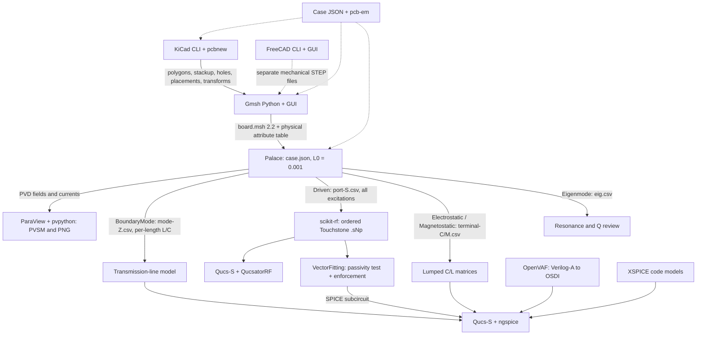

# PCB EM Lab

Supported platform: **Linux**.

Portable, file-based PCB simulation using KiCad 10, Gmsh and Palace. Board-specific
inputs live with the hardware; this repository supplies the reusable tooling.
The supplied [differential-pair example](examples/differential-pair/README.md)
runs independently; no hardware checkout is needed.

CPU, tools and CUDA workflows have been exercised on the laptop. See
[validation status](docs/validation.md) for passed checks and numerical limitations. Generated BMS models are exploratory, and do
not establish impedance acceptance, EMC compliance or component qualification.

## Quick start

Use an x86-64 Linux machine with Python 3 and rootless Podman. CPU operation has
no NVIDIA requirement. The launcher works directly from this checkout. Case
files use JSON and are read with Python's standard library; no host Python
packages are required.

```bash
git clone https://github.com/gerhardmalberg88/pcb-em-lab.git
cd pcb-em-lab
./pcb-em bootstrap
./pcb-em build --profile cpu --jobs 2
./pcb-em doctor --backend cpu --full
./pcb-em run examples/differential-pair/case.json --backend cpu
# Optional small 3D case: two-port network, fields and circuit handoffs
./pcb-em run examples/differential-pair/driven.json --backend cpu
```

The example guide includes GUI commands for its PCB, STEP export, constructed
geometry, mesh, solver inputs and ParaView results. Palace itself uses a JSON
input and command-line solver; its settings can be edited in a GUI text editor.
The supplied VS Code workspace adds menu tasks for every stage and GUI launcher.
Generated files stay under ignored `results/examples/differential-pair/`.

To expose `pcb-em` from another working directory, install it into a local
virtual environment (requires your distribution's `python3-venv`,
`python3-setuptools` and `python3-wheel` packages):

```bash
python3 -m venv --system-site-packages .venv
. .venv/bin/activate
python -m pip install --no-build-isolation -e .
pcb-em run "$PWD/examples/differential-pair/case.json" --backend cpu
```

CUDA is optional. Install the container integration after confirming that the
host GPU works. The bootstrap script never installs a graphics driver.
CUDA images can be compiled without GPU access; driver-dependent version and
solver checks run afterward through `doctor` in the GPU-enabled runtime.

```bash
./pcb-em bootstrap --cuda
./pcb-em build --profile cuda --cuda-arch 75 --cuda-version 12.9.1
./pcb-em doctor --backend cuda --full
./pcb-em run examples/differential-pair/case.json --backend cuda --mpi-ranks 1
./pcb-em build --profile all --cuda-arch 75
```

`cpu` builds the CPU solver and shared tools. `cuda` builds the additional solver;
`all` builds CPU, tools and CUDA. Two build jobs are the default. Failed build
containers, downloads and logs are retained to diagnose and resume failures.
An initial source build can take several hours on a laptop; subsequent builds
reuse matching images and compiled dependencies. Maintained environment manifests use
JSON (`env/*.json` and `env/locks/*/spack.json`). Inside build containers the
installer copies that JSON to Spack's required `spack.yaml` filename; it exports
the original JSON manifest and the resolved `spack.lock`. See the
[storage and transfer notes](docs/servers.md) before building or exporting all profiles.
Completed builders are removed after their image and provenance are saved;
the image retains the compiled package cache. Images are
`localhost/pcb-em-{tools,cpu,cuda}:0.1`. Spack environments and exported locks are
under `env/`; artifact versions and SHA-256 values are in `env/pins.json`.
Spack source archives are shared between builds in `.cache/spack-source`;
downloaded GUI distributions are retained in `.cache/upstream`.

The tools image includes KiCad, FreeCAD, Gmsh, ParaView/pvpython, scikit-rf,
Qucs-S/QucsatorRF, ngspice with XSPICE/OSDI, and OpenVAF. KiCad's system Python,
FreeCAD's Python, ParaView's Python and numerical `pcb-python` exchange files;
their binary Python modules are never imported into one shared interpreter.

| Tool | Pinned starting version |
|---|---|
| Spack / Palace | 1.2.2 / 0.18.1 |
| KiCad / FreeCAD | 10.0.7 / 1.1.3 |
| Gmsh / ParaView | 4.15.2 / 6.2.0 |
| scikit-rf / Qucs-S | 1.8.0 / 26.1.1 (bundles QucsatorRF) |
| ngspice / OpenVAF | 46 with XSPICE and OSDI / 23.5.0 |
| CUDA toolkit | 12.9.1; optional, architecture configurable |

Ubuntu packages use the 2026-10-27 UTC snapshot; KiCad's PPA packages are pinned
to exact versions. Completed builds export dependency locks, package inventories
and image IDs. Python wheels are resolved once into a hash lock and replayed with
hash verification. GUI binaries are upstream distributions checked against their
recorded SHA-256 values. Export the images for an exact portable runtime snapshot.

## EM workflow

This is the simplified supplied EM workflow. Solid arrows are file handoffs;
dashed arrows are optional geometry or orchestration. Electrostatic and
Eigenmode remain documented extension paths, outside the initial case generator.



Copper and layer heights come from the saved PCB, including existing fills and
keepouts. Extraction never saves or refills the design. Every run records source
hashes and tool image IDs. Mechanical parts remain separate; they do not replace
the PCB copper. Inspect integer boundary tags and port polarity before drawing
physical conclusions. A 2D mode index alone does not identify the differential mode.

## Execution and results

```json
{
  "execution": {
    "backend": "auto",
    "mpi_ranks": 2,
    "threads_per_rank": 1,
    "gpu_count": 1
  }
}
```

`backend` accepts `auto`, `cpu` or `cuda`. Omit `mpi_ranks` for the defaults
of two CPU ranks or one GPU rank. CLI options override these preferences.
Explicit CPU selection never probes
NVIDIA. Auto selection checks the CUDA image and container device access, then
reports either CUDA selection or its reason for choosing CPU. Explicit CUDA
fails if unavailable. Solver or model failures stop the run; they never change
the backend. An explicitly configured MPI rank count is honored; for CUDA it
must not exceed `gpu_count`.

```bash
./pcb-em run CASE.json --mode 2d --backend cpu --stage all
./pcb-em run CASE.json --backend auto --stage mesh
./pcb-em run CASE.json --backend cpu --mpi-ranks 2 --threads-per-rank 1
```

Stages are `extract`, `mesh`, `solve`, `postprocess`, `all`. Selecting a stage also
ensures its prerequisites exist. Successful stages are reused only when source,
physical configuration, implementation, tool image and artifact hashes match.
`--force` reruns the selected stages. Each configured output directory owns its
stage subdirectories; reruns replace their contents. Keep manual work elsewhere.
The source checkout is mounted read-only, and only the results directory is writable.

See [case configuration](docs/cases.md), [server transfer](docs/servers.md), and
[validation status](docs/validation.md). Open GUI tools on a writable work copy:

```bash
./pcb-em gui paraview --workdir /absolute/path/to/results
./pcb-em gui kicad --workdir /absolute/path/to/design-copy -- /work/board.kicad_pro
```

GUI forwarding uses the existing X11/XWayland authentication cookie; it does not
disable X server access control. Headless rendering uses Xvfb and software OpenGL.
GUI preferences persist separately for each application under ignored `.cache/gui/`.

## Licensing and sources

The original software, build recipes, configuration and documentation in this
repository are licensed under [Apache-2.0](LICENSE).
Copyright 2026 Gerhard Malberg; see [NOTICE](NOTICE).
The separate BMS hardware repository, including its case inputs, retains
CERN-OHL-P-2.0. Installed third-party programs and downloaded upstream sources
retain their own licenses. Refer to the pinned upstream sources in `env/pins.json` and
the package inventory exported with each image. Numerical algorithms and JSON
configuration follow the [Palace documentation](https://awslabs.github.io/palace/).
For the Ubuntu 24.04 Podman/NVIDIA CDI compatibility setting, see
[NVIDIA release notes](https://docs.nvidia.com/datacenter/cloud-native/container-toolkit/latest/release-notes.html#known-issues).
